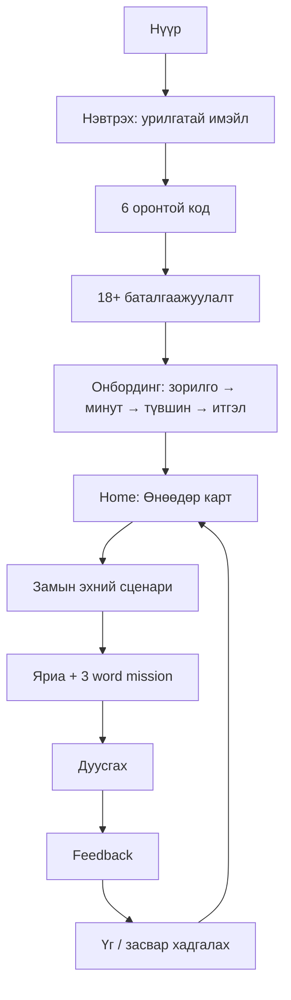
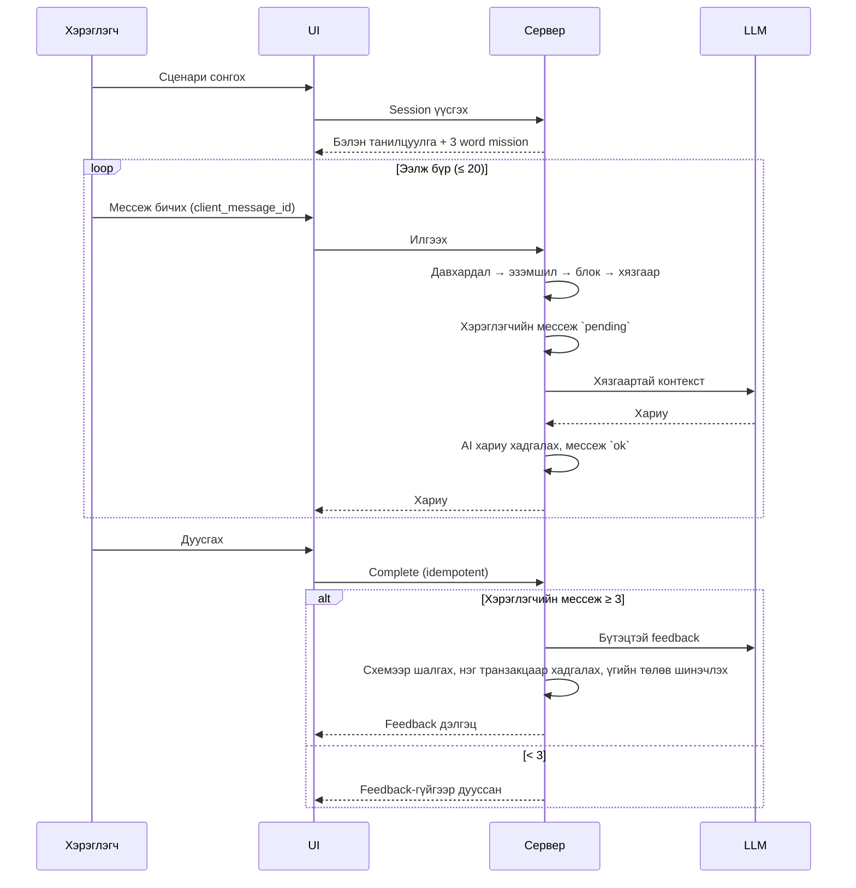
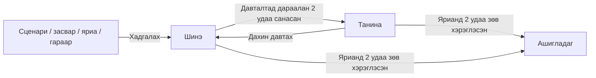

# App Flow — Хэрэглэгчийн урсгал

**Холбоос:** [prd.md](./prd.md) · [design_system.md](./design_system.md)

---

## 1. Дэлгэцүүд (1-р шат)

| Код | Дэлгэц | Route | Тайлбар |
|---|---|---|---|
| S01 | Нүүр | `/` | Үнэ цэнийн санал, "Нэвтрэх" (урилгаар pilot) |
| S02 | Нэвтрэх | `/login` | Имэйл → 6 оронтой код |
| S02a | Насны баталгаажуулалт | `/age-confirmation` | "Би 18 ба түүнээс дээш настай" (анхны нэвтрэлт) |
| S03 | Онбординг | `/onboarding` | 4 алхам |
| S04 | Home | `/home` | "Өнөөдөр" карт, товч ахиц (M12). M2–M11: мэндчилгээ + "Гарах" |
| S05 | Сургалтын зам | `/path` | Түвшин → бүлэг → сценари |
| S06 | Яриа | `/talk/[sessionId]` | AI ярилцагч, Hint, word missions |
| S07 | Feedback | `/talk/[sessionId]/feedback` | Сайн тал, засвар, word missions |
| S07a | Өмнөх яриа | `/history` | Яриануудын жагсаалт |
| S08 | Үгсийн сан | `/words` | Жагсаалт, хайлт, шүүлт |
| S09 | Давталт | `/review` | Карт |
| S10 | Ахиц | `/progress` | Үзүүлэлт, алдааны төрөл |
| S11 | Тохиргоо | `/settings` | Сонголт, бүртгэл устгах хүсэлт |

Route-ийн нэр хэрэгжүүлэх үед өөрчлөгдөж болно; урсгал ба хандалтын дүрэм хэвээр үлдэнэ. Нийтийн бүртгүүлэх дэлгэц байхгүй (урилгаар).

## 2. Анхны хэрэглэгч



- Код илгээх мессеж нь имэйл урилгад байгаа эсэхийг илчлэхгүй.
- Хамгаалагдсан хуудасны чиглүүлэлт (давталтгүй): нэвтрээгүй → `/login?next=…`; `age_confirmed_at` хоосон → `/age-confirmation`; `onboarding_completed_at` хоосон → `/onboarding` (M3-аас; M2-д 18+ баталгаажуулсны дараа `/home`).

## 3. Буцаж ирсэн хэрэглэгч

"Өнөөдөр" карт дараах дарааллаар **нэг** гол санал харуулна:
1. Дуусаагүй яриа үргэлжлүүлэх (`active`, сүүлийн идэвхжилтээс 24 цаг хүрээгүй; хэд байвал хамгийн сүүлийнх)
2. Хугацаа болсон давталт (байвал)
3. Замын дараагийн сценари

24 цагаас дээш идэвхгүй яриа `abandoned` болно. Чөлөөт яриа хойшлогдсон.

## 4. Ярианы урсгал



**Хадгалах дараалал (ADR-003):** хэрэглэгчийн мессежийг AI дуудахаас **өмнө** `pending` төлөвтэй хадгална. AI амжилтгүй бол `reply_failed`; "Дахин оролдох" нь ижил мессежид шинэ хариу авна. `pending`/`reply_failed` мессеж байхад шинэ мессеж илгээхгүй.

### Ярианы дэлгэц
- Дээд: сценарийн нэр, word missions chip (хэрэглэсэн нь ✓)
- Гол: эхэнд сценарийн танилцуулга, дараа нь мессеж бөмбөлгүүд
- Доод: бичих талбар, "Hint", "Илгээх", "Дуусгах"

### Алдаа ба онцгой төлөв
| Нөхцөл | Хариу |
|---|---|
| Хоосон мессеж | Client дээр хориглож, сервер дээр ч шалгана |
| Хэт урт (> 1000) | Хязгаарыг тодорхой хэлнэ |
| AI timeout / алдаа | "Таны мессеж хадгалагдсан. Хариу ирсэнгүй." + Дахин оролдох; Composer түгжигдэнэ |
| AI-ийн буруу бүтэцтэй гаралт | Төсөв дотор 1 удаа дахин оролдоно → сэргээх боломжтой алдаа |
| Хариу хүлээгдэж буй (`IN_PROGRESS`) | Хүлээх төлөв, дахин ачаалахад шинэчилнэ |
| Сүлжээ тасарсан | Ижил `client_message_id`-тэй дахин илгээнэ; хадгалагдсан эсэхийг хэлнэ |
| Нэвтрэлт дууссан | Дахин нэвтрүүлж, бичсэн ноорогийг хадгална (боломжтой бол) |
| Өдрийн хариуны хязгаар (40) | "Өнөөдрийн ярианы хязгаар дууслаа — үгээ давтаж болно" |
| Hint-ийн хязгаар (10) | "Өнөөдрийн hint дууслаа" (яриа үргэлжилнэ) |
| Ээлжийн хязгаар (20) | "Сайн ярилаа! Одоо feedback-ээ харъя" → Дуусгах |
| < 3 мессежтэй "Дуусгах" | "Feedback авахын тулд дор хаяж 3 мессеж бичнэ үү" → "Үргэлжлүүлэх" / "Feedback-гүйгээр дуусгах" |

## 5. Feedback дэлгэц

1. **Сайн хийсэн зүйлс** (2–3)
2. **Сайжруулах зүйлс** (≤ 5): `Таны хэлсэн` → `Илүү зөв` + тайлбар; `style` төрлийнх нь "Илүү байгалийн хувилбар" гэж тэмдэглэгдэнэ
3. **Word missions:** хэрэглэсэн / зөв хэрэглэсэн / үлдсэн
4. **Энэ ярианы тоо:** үгийн тоо, ойролцоо алдааны тоо ("ойролцоо" шошготой)
5. Үйлдэл: "Үгсийн санд нэмэх", "Буруу засвар", "Дахин ярих", "Home"

Төлөв: `pending` → бэлтгэж байна (polling); `failed` → "Дахин үүсгэх" (нэг ярианд 1 удаа); `skipped` → "Энэ ярианд feedback байхгүй".

## 6. Үгсийн сан ба давталт



- `Ашигладаг` үг "Дахин давтах" авбал төлөв хэвээр, интервал 1 хоног.
- Давхар хадгалалт → "Аль хэдийн хадгалсан" (шинэ мөр үүсгэхгүй).
- Яриа эсвэл гараар хадгалахад утгаа заавал бичнэ; сценари ба засвараас хадгалахад утга автоматаар бөглөгдөнө.
- Word missions: хэрэглэгчийн "Шинэ"/"Танина" үгсээс ≤ 2 + сценарийн үгс (нийт 3).

## 7. Хамгаалагдсан үйлдлийн урсгал

```
Хүсэлт → Origin шалгах → оролт шалгах → итгэлтэй session-оос хэрэглэгчийг тодорхойлох
      → эзэмшил шалгах → хязгаартай үйлдэл (service модуль / DB функц) → аюулгүй хариу
```
UI дээр товч нуух нь эрхийн шалгалт биш.

## 8. UI төлөвүүд ба хүртээмж

- Өгөгдөлтэй дэлгэц бүр: loading, empty, success, error, retry, disabled.
- Гол үйлдэл бүрт гарнаас хүрнэ; focus харагдана.
- Утсан дээр бичих талбар үргэлж хүрэхэд хялбар, хэвтээ гүйлгээгүй.

## 9. 2-р шатанд нэмэгдэх

- Нэвтрэх: Google
- Яриа: дуугаар ярих товч (push-to-talk), AI-ийн хариуг сонсох
- Онбординг: түвшин тогтоох тест (сонголттой)
- Home: streak, сануулга

## 10. Хойшлуулсан

- AI мессежийн монгол орчуулга
- Ярианы явцын шууд засвар
- Чөлөөт яриа
