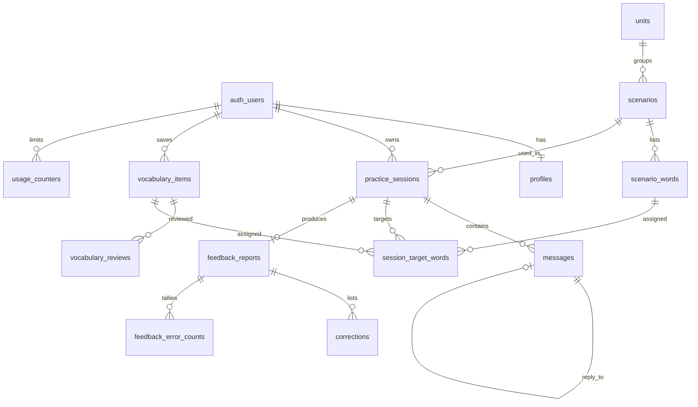

# Backend Schema — Өгөгдлийн сан ба API

**Холбоос:** [trd.md](./trd.md) · [security.md](./security.md) · [ADR-004](./adr/ADR-004-rls-read-only.md) · [ADR-005](./adr/ADR-005-server-write-path.md)

Доорх SQL нь **санал**. Migration-д хэрэгжүүлж, тестээр баталгаажуулна. Postgres-ийн хувилбараас хамаарах боломжуудыг (`on delete set null (багана)` г.м.) Supabase-ийн одоогийн хувилбар дээр **шалгах шаардлагатай**.

---

## 1. Зарчмууд

- PostgreSQL — цорын ганц эх сурвалж.
- UUID primary key, `timestamptz` (UTC). "Өдөр", "долоо хоног"-ийг **Asia/Ulaanbaatar** цагийн бүсээр тооцно.
- Хэрэглэгчийн мөр бүр `auth.users`-тай шууд эсвэл эцэгээр холбогдоно. Эцэг-хүүхдийн **эзэмшлийн тууштай байдлыг composite FK** (`(parent_id, user_id)`) баталгаажуулна — trigger-ээр биш.
- `public` schema-ийн **бүх** хүснэгтэд RLS асаалттай. Хэрэглэгчийн session-тэй client-д зөвхөн `select` policy (ADR-004).
- Бүх бичилт серверээр: нэг мөрийн бичилт — server-only service модуль (service role, эзэмшлийг кодоор шалгана); олон алхамт транзакц — Postgres функц, `EXECUTE` нь `public`, `anon`, `authenticated`-ээс хураагдсан (ADR-005).
- Нууц түлхүүрийг DB-д хадгалахгүй.

## 2. Хүснэгтүүд

### 2.0 Төрлүүд

```sql
create type english_level as enum ('A1','A2','B1');
create type error_category as enum
  ('grammar','tense','article','preposition','word_order','vocabulary','other');
-- 'grammar' = бусад ангилалд ороогүй дүрмийн алдаа
```

### 2.1 Хэрэглэгч

```sql
create table profiles (
  id uuid primary key references auth.users(id) on delete cascade,
  display_name text,
  english_level english_level not null default 'A2',
  goals text[] not null default '{}'
    check (goals <@ array['work','school','travel','daily']),
  daily_minutes_goal int not null default 10 check (daily_minutes_goal in (5,10,20)),
  baseline_confidence smallint check (baseline_confidence between 1 and 5),
  age_confirmed_at timestamptz,          -- 18+ баталгаажуулалт (pilot)
  onboarding_completed_at timestamptz,
  created_at timestamptz not null default now(),
  updated_at timestamptz not null default now()
);
```

- Profile-ийг `auth.users` дээрх `after insert` trigger (`security definer`, `set search_path = ''`) default утгатай үүсгэнэ. Хэрэглэгчийн `insert` policy байхгүй.
- `updated_at`-ийг бүх хүснэгтэд нэг `set_updated_at()` trigger шинэчилнэ.
- `realtime_corrections` багана **хасагдсан** (шууд засвар MVP-д байхгүй).

### 2.2 Агуулга (зөвхөн агуулгын скрипт / service role бичнэ)

Агуулгын эх сурвалж нь `content/units.json` ба `content/scenarios/<slug>.json` (`src/features/path/content-schema.ts`-ийн Zod схемээр шалгана); `npm run content:sync` (`scripts/upsert-content.mts`, service role) нь idempotent upsert хийнэ (local ба production-д ижил скрипт; `db:reset` мөн үүнийг дууддаг). Хэрэгжүүлэлт (M4):
- Түлхүүр: сценари — `slug`; бүлэг — `(english_level, position)` (бүлэгт `slug` байхгүй). Өөрчлөгдөөгүй мөрийг бичихгүй — хоёр дахь ажиллалт юу ч өөрчлөхгүй.
- Хэзээ ч устгахгүй: файлаас хасагдсан бүлэг/сценари → `is_active = false`. `unique (unit_id, position)` идэвхгүй мөрд ч хамаарах тул байрлалаа шинэ сценарид шилжүүлэх идэвхгүй сценари тухайн бүлгийн сөрөг байрлал руу шилжинэ.
- DB-д байгаа сценариас үг хасагдвал sync бичилт хийхээс өмнө алдаагаар зогсоно (M9-ийн `session_target_words` холбоосыг эвдэхгүйн тулд); хасах бол тусдаа migration.
- Pilot: түвшин тутамд **1 бүлэг** (баримтад бүлгийн тоо заагаагүй). `review_status` (`draft`/`reviewed`) нь зөвхөн файлд; DB-д хадгалахгүй. Багшийн хяналтын хүснэгт: `docs/content_review.md` (`npm run content:review`).
- RLS: сценари нь бүлэг нь идэвхтэй үед, үг нь сценари (ба бүлэг) нь идэвхтэй үед л харагдана; `anon`-д эрх байхгүй.

```sql
create table units (
  id uuid primary key default gen_random_uuid(),
  english_level english_level not null,
  position int not null,
  title_mn text not null,
  goal_tags text[] not null default '{}',
  is_active boolean not null default true,
  unique (english_level, position)
);

create table scenarios (
  id uuid primary key default gen_random_uuid(),
  unit_id uuid not null references units(id),
  position int not null,
  slug text unique not null,
  title_mn text not null,
  goal_mn text not null,
  ai_role text not null,
  user_role text not null,
  role_context text not null,            -- LLM-д өгөх нөхцөл
  intro_en text not null,                -- ярианы эхний мессеж (бэлэн текст, LLM дуудлагагүй)
  english_level english_level not null,
  is_active boolean not null default true,
  created_at timestamptz not null default now(),
  updated_at timestamptz not null default now(),
  unique (unit_id, position)
);

create table scenario_words (
  id uuid primary key default gen_random_uuid(),
  scenario_id uuid not null references scenarios(id) on delete cascade,
  position int not null,
  term text not null,
  normalized_term text not null generated always as (normalize_term(term)) stored,
  meaning_mn text not null,              -- багшийн хянасан утга
  example_en text,
  unique (scenario_id, normalized_term)
);
```

Pilot-ийн агуулга: түвшин тутамд 4 сценари (нийт 12), сценари бүр 3–6 үгтэй, англи хэлний багш хянасан.

### 2.3 Яриа

```sql
create table practice_sessions (
  id uuid primary key default gen_random_uuid(),
  user_id uuid not null references auth.users(id) on delete cascade,
  scenario_id uuid not null references scenarios(id),   -- чөлөөт яриа хойшлогдсон
  status text not null default 'active'
    check (status in ('active','completed','abandoned')),
  english_level_at_start english_level not null,
  learner_turn_count int not null default 0,
  feedback_status text not null default 'none'
    check (feedback_status in ('none','skipped','pending','ready','failed')),
  feedback_attempts smallint not null default 0 check (feedback_attempts between 0 and 2),
  feedback_started_at timestamptz,
  last_activity_at timestamptz not null default now(),
  started_at timestamptz not null default now(),
  completed_at timestamptz,
  unique (id, user_id)
);
create index on practice_sessions (user_id, last_activity_at desc);
create index on practice_sessions (scenario_id);

create table messages (
  id uuid primary key default gen_random_uuid(),
  seq bigint generated always as identity,        -- дараалал (created_at биш)
  session_id uuid not null,
  user_id uuid not null,
  role text not null check (role in ('user','assistant')),
  content text not null check (char_length(content) between 1 and 4000),
  status text not null default 'pending'
    check (status in ('pending','ok','reply_failed')),
  client_message_id uuid,
  reply_to_message_id uuid references messages(id) on delete cascade,
  used_hint boolean not null default false,
  created_at timestamptz not null default now(),
  updated_at timestamptz not null default now(),
  foreign key (session_id, user_id)
    references practice_sessions (id, user_id) on delete cascade,
  unique (id, user_id),
  unique (session_id, client_message_id),
  unique (reply_to_message_id),                   -- нэг мессежид нэг хариу
  check (role <> 'user' or (client_message_id is not null
                            and char_length(content) <= 1000)),
  check (role <> 'assistant' or (status = 'ok' and reply_to_message_id is not null))
);
create index on messages (session_id, seq);
create index on messages (user_id);
```

- Сценарийн танилцуулга (`scenarios.intro_en`) мессеж болж хадгалагдахгүй; UI ба context builder эхний assistant ээлж болгон оруулна.
- **Хэрэглэгчийн мессежийн төлөв:** `pending` (AI хариу хүлээж буй) → `ok` (хариу хадгалагдсан) | `reply_failed`. `pending` нь `updated_at`-аас хойш `AI_REPLY_DEADLINE_MS × 2`-оос удвал уншихад болон дараагийн бичилтэд `reply_failed` болгоно (lazy expiry, cron шаардахгүй).
- Session-д `pending` эсвэл `reply_failed` мессеж байвал шинэ мессеж хүлээж авахгүй (`MESSAGE_BLOCKED`) — хэрэглэгч "Дахин оролдох" дарна.
- Ээлжийн хязгаар: `learner_turn_count < CONVERSATION_MAX_TURNS` (default 20).
- `used_hint` — client-ийн мэдээлэл (зөвхөн статистик), эрхийн шийдвэрт ашиглахгүй.
- 24 цагаас дээш идэвхгүй (`last_activity_at`) `active` session-ийг уншихад болон шинэ session эхлэхэд `abandoned` болгоно.

```sql
-- Тухайн ярианы word missions (migration-д vocabulary_items-ийн дараа)
create table session_target_words (
  id uuid primary key default gen_random_uuid(),
  session_id uuid not null,
  user_id uuid not null,
  mission_key smallint not null check (mission_key between 1 and 3),
  source text not null check (source in ('vocabulary','scenario')),
  vocabulary_item_id uuid,
  scenario_word_id uuid references scenario_words(id) on delete set null,
  term text not null,                    -- snapshot: эх мөр устсан ч түүх үлдэнэ
  normalized_term text not null,
  meaning_mn text not null,
  used boolean not null default false,
  used_correctly boolean not null default false,
  foreign key (session_id, user_id)
    references practice_sessions (id, user_id) on delete cascade,
  foreign key (vocabulary_item_id, user_id)
    references vocabulary_items (id, user_id) on delete set null (vocabulary_item_id),
  unique (session_id, mission_key),
  unique (session_id, normalized_term),
  check (not used_correctly or used)
);
create index on session_target_words (vocabulary_item_id);
create index on session_target_words (scenario_word_id);
```

**Mission сонгох дүрэм** (`start_session` функц дотор):
1. Нийт 3 mission.
2. Хэрэглэгчийн `new`/`known` төлөвтэй үгсээс дээд тал нь 2 (`used_in_conversation_count asc, created_at asc`).
3. Үлдсэнийг сценарийн үгсээс (`position`-ийн дарааллаар), аль хэдийн сонгогдсон эсвэл хэрэглэгчийн `active` үгтэй ижил `normalized_term`-ийг алгасна.
4. `active` үг mission болохгүй (`prd.md §FR-07`).
5. Шинэ хэрэглэгчийн бүх mission сценарийн үгээс ирнэ — үгсийн санд автоматаар нэмэгдэхгүй.

### 2.4 Feedback

```sql
create table feedback_reports (
  id uuid primary key default gen_random_uuid(),
  session_id uuid not null unique,
  user_id uuid not null,
  strengths_mn text[] not null check (cardinality(strengths_mn) between 2 and 3),
  word_count int not null check (word_count >= 0),     -- сервер тооцно
  error_count int not null check (error_count >= 0),   -- error_tally-ийн нийлбэр
  provider text not null,
  model text not null,
  prompt_version text not null,
  created_at timestamptz not null default now(),
  foreign key (session_id, user_id)
    references practice_sessions (id, user_id) on delete cascade,
  unique (id, user_id)
);
create index on feedback_reports (user_id, created_at desc);

-- Бүх алдааны ойролцоо тоо (харуулсан ≤ 5 засвараас үл хамаарна)
create table feedback_error_counts (
  report_id uuid not null,
  user_id uuid not null,
  category error_category not null,
  count int not null check (count > 0),
  primary key (report_id, category),
  foreign key (report_id, user_id)
    references feedback_reports (id, user_id) on delete cascade
);
create index on feedback_error_counts (user_id);

create table corrections (
  id uuid primary key default gen_random_uuid(),
  report_id uuid not null,
  user_id uuid not null,
  position smallint not null check (position between 1 and 5),
  message_id uuid,
  original text not null,
  corrected text not null,
  explanation_mn text not null,
  kind text not null check (kind in ('error','style')),
  category error_category not null,
  user_flagged_wrong boolean not null default false,
  flagged_at timestamptz,
  created_at timestamptz not null default now(),
  foreign key (report_id, user_id)
    references feedback_reports (id, user_id) on delete cascade,
  foreign key (message_id, user_id)
    references messages (id, user_id) on delete set null (message_id),
  unique (report_id, position),
  check (original <> corrected)
);
create index on corrections (user_id, created_at desc);
create index on corrections (message_id);
```

- `feedback_reports.used_target_words` **хасагдсан** — mission-ий үр дүнгийн цорын ганц эх сурвалж нь `session_target_words`.
- LLM-ийн түүхий JSON-ийг хадгалахгүй (D-06). Буруу гаралтын үед зөвхөн Zod алдааны path-ийг (агуулгагүй) логлоно.
- **Feedback төлөв** (`practice_sessions.feedback_status`):
  - `none` → (`complete`, хэрэглэгчийн мессеж < 3) → `skipped`
  - `none` | `failed` → (`claim_feedback`, `feedback_attempts < 2`) → `pending`
  - `pending` → `ready` (`save_feedback`) | `failed` (`fail_feedback`, эсвэл `feedback_started_at`-аас 120 сек давсан — lazy)
  - Нэг session-д 1 feedback + 1 regenerate (`feedback_attempts ≤ 2`).

### 2.5 Үгсийн сан

```sql
create function normalize_term(t text) returns text
  language sql immutable
  as $$ select regexp_replace(lower(btrim(replace(t, '’', ''''))), '\s+', ' ', 'g') $$;
-- Unicode NFC-г нэмэх эсэх, immutable байдлыг хэрэгжүүлэх үед шалгана.

create table vocabulary_items (
  id uuid primary key default gen_random_uuid(),
  user_id uuid not null references auth.users(id) on delete cascade,
  term text not null check (char_length(term) between 1 and 100),
  normalized_term text not null generated always as (normalize_term(term)) stored,
  meaning_mn text not null check (char_length(meaning_mn) between 1 and 500),
  example_sentence text,
  source text not null check (source in ('scenario','correction','conversation','manual')),
  source_message_id uuid,
  state text not null default 'new' check (state in ('new','known','active')),
  remembered_streak int not null default 0,
  used_in_conversation_count int not null default 0,
  interval_days int not null default 1 check (interval_days in (1,3,7,14)),
  next_review_at timestamptz not null default now(),
  created_at timestamptz not null default now(),
  updated_at timestamptz not null default now(),
  foreign key (source_message_id, user_id)
    references messages (id, user_id) on delete set null (source_message_id),
  unique (user_id, normalized_term),
  unique (id, user_id)
);
create index on vocabulary_items (user_id, next_review_at);
create index on vocabulary_items (user_id, state);
create index on vocabulary_items (source_message_id);

create table vocabulary_reviews (
  id uuid primary key default gen_random_uuid(),
  user_id uuid not null,
  vocabulary_item_id uuid not null,
  result text not null check (result in ('remembered','practice_again')),
  reviewed_at timestamptz not null default now(),
  foreign key (vocabulary_item_id, user_id)
    references vocabulary_items (id, user_id) on delete cascade
);
create index on vocabulary_reviews (user_id, reviewed_at desc);
create index on vocabulary_reviews (vocabulary_item_id);
```

**Утгын эх сурвалж** (`meaning_mn` заавал):
| `source` | `term` | `meaning_mn` |
|---|---|---|
| `scenario` | Сценарийн үг | `scenario_words.meaning_mn` (хянасан) |
| `correction` | Засварын `corrected` хэллэг | Засварын `explanation_mn` |
| `conversation`, `manual` | Хэрэглэгч сонгосон/бичсэн | Хэрэглэгч заавал бичнэ |

LLM-ээр утга үүсгэхгүй.

**Үгийн төлөвийн машин** (цэвэр функц, `src/features/vocabulary/`; DB-д `record_review`, `save_feedback` функц хэрэгжүүлнэ):

Интервалын шат: `1 → 3 → 7 → 14` хоног (14 дээр тогтоно). `next_review_at = now() + interval_days`.

| Одоогийн төлөв | Үйл явдал | Шинэ төлөв | `remembered_streak` | `interval_days` |
|---|---|---|---|---|
| `new` | `remembered` | streak ≥ 2 бол `known`, эс бөгөөс `new` | +1 | дараагийн шат |
| `known` | `remembered` | `known` | +1 | дараагийн шат |
| `active` | `remembered` | `active` | +1 | дараагийн шат |
| `new` | `practice_again` | `new` | 0 | 1 |
| `known` | `practice_again` | `new` | 0 | 1 |
| `active` | `practice_again` | `active` | 0 | 1 |
| `new`, `known` | mission-д `used_correctly` (session тутамд ≤ +1) | `used_in_conversation_count` ≥ 2 бол `active` | — | — |
| `active` | mission-д `used_correctly` | `active` | — | — |

- "2 удаа санасан" = **дараалсан** 2 `remembered`.
- `new → active` шууд шилжилт зөвшөөрөгдөнө (ярианд 2 удаа зөв хэрэглэсэн).
- `active` үг давталтын дараалалд үлдэнэ. `active` үг "Дахин давтах" (`practice_again`) авбал төлөв нь `active` хэвээр үлдэж, давталтын интервал нь **1 хоног** болж шинэчлэгдэнэ (`next_review_at = now() + 1 хоног`, `remembered_streak = 0`).
- Шинэ үг хадгалмагц (`next_review_at = now()`) давталтад орно.

### 2.6 AI хэрэглээ ба хязгаар (зөвхөн сервер)

```sql
create table ai_usage_events (
  id uuid primary key default gen_random_uuid(),
  user_id uuid references auth.users(id) on delete set null,
  operation text not null check (operation in ('reply','feedback','hint')),
  provider text,                          -- rate_limited үед null
  model text,
  prompt_version text,
  attempt smallint not null default 1,
  input_tokens int,
  output_tokens int,
  estimated_cost numeric,
  status text not null
    check (status in ('ok','timeout','provider_error','invalid_output','rate_limited')),
  latency_ms int,
  created_at timestamptz not null default now()
);
create index on ai_usage_events (user_id, created_at desc);
create index on ai_usage_events (created_at);

-- Өдрийн хязгаарын тоолуур (Asia/Ulaanbaatar өдөр)
create table usage_counters (
  user_id uuid not null references auth.users(id) on delete cascade,
  day date not null,
  operation text not null check (operation in ('reply','hint')),
  count int not null default 0,
  primary key (user_id, day, operation)
);
```

- Prompt болон мессежийн агуулгыг `ai_usage_events`-д бичихгүй. Энгийн хэрэглэгчид харагдахгүй.
- `ai_usage_events`-ийг **12 сар** хадгална; бүртгэл устгахад `user_id → null`.
- Хязгаар: `reply` 40/өдөр, `hint` 10/өдөр (env-ээр). Feedback нь өдрийн хязгаарт тоологдохгүй, session тутамд `feedback_attempts ≤ 2`. Тоолуурыг атомар `insert ... on conflict do update ... where count < limit returning`-ээр нэмнэ.

### 2.7 Бүртгэл устгах хүсэлт

```sql
create table account_deletion_requests (
  id uuid primary key default gen_random_uuid(),
  user_id uuid not null,                 -- FK-гүй: устгалын дараа аудитад үлдэнэ
  requested_at timestamptz not null default now(),
  status text not null default 'requested'
    check (status in ('requested','completed','cancelled')),
  completed_at timestamptz
);
create unique index on account_deletion_requests (user_id) where status = 'requested';
```

## 3. Холбоос



## 4. RLS ба эрх

**Бүх** `public` хүснэгтэд `enable row level security`. CI-д "RLS асаагүй `public` хүснэгт байхгүй" гэсэн SQL шалгалт ажиллана.

| Хүснэгт | `authenticated` policy | Бичих |
|---|---|---|
| `profiles` | `select`: `id = (select auth.uid())` | Service модуль |
| `practice_sessions`, `vocabulary_items`, `vocabulary_reviews`, `feedback_reports`, `feedback_error_counts`, `corrections`, `messages`, `session_target_words` | `select`: `user_id = (select auth.uid())` | Service модуль / DB функц |
| `account_deletion_requests` | `select`: өөрийн мөр | Service модуль |
| `units`, `scenarios`, `scenario_words` | `select`: `is_active` (эцгийн `is_active`) | Агуулгын скрипт |
| `ai_usage_events`, `usage_counters` | Policy байхгүй | Зөвхөн service role |

```sql
alter table practice_sessions enable row level security;
create policy "read own sessions" on practice_sessions
  for select to authenticated using (user_id = (select auth.uid()));
-- insert / update / delete policy үүсгэхгүй.
```

- `(select auth.uid())` хэлбэр нь Supabase-ийн гүйцэтгэлийн зөвлөмж — **шалгах шаардлагатай**.
- `anon` role-д хэрэглэгчийн хүснэгт дээр policy байхгүй.
- RLS-ийг **хоёр өөр тест хэрэглэгчээр**, API-гаар болон anon түлхүүртэй Supabase client-ээр шууд шалгана (`testing.md §3`).

### 4.1 DB функцууд (ADR-005)

Бүх функц: `security invoker`, `set search_path = ''`, эхний параметр `p_user_id` (сервер баталгаажсан session-оос дамжуулна) ба эзэмшлийг дотроо шалгана.

```sql
revoke execute on function <fn> from public, anon, authenticated;
grant execute on function <fn> to service_role;
```

Supabase-ийн default privilege нь шинэ функцэд `anon`/`authenticated`-д эрх өгдөг эсэхийг **шалгах шаардлагатай**; migration-д `alter default privileges`-ээр хаана.

| Функц | Үүрэг |
|---|---|
| `start_session(p_user_id, p_scenario_id)` | Хуучирсан session-ийг `abandoned`; session + 3 mission үүсгэнэ |
| `begin_user_turn(p_user_id, p_session_id, p_client_message_id, p_content, p_used_hint, p_daily_limit, p_max_turns)` | Давхардал шалгах (давхардал бол хуучин үр дүн, квот хасахгүй) → эзэмшил, `active`, блок, ээлжийн хязгаар → квот → `pending` мессеж |
| `begin_retry(p_user_id, p_message_id, p_daily_limit)` | `reply_failed` → `pending`, квот хасна |
| `finish_user_turn(p_user_id, p_message_id, p_reply)` | Хариутай бол assistant мессеж + `ok`; хариугүй бол `reply_failed` |
| `consume_quota(p_user_id, p_operation, p_limit)` | Hint-ийн өдрийн квот |
| `complete_session(p_user_id, p_session_id)` | Idempotent; < 3 хэрэглэгчийн мессеж бол `feedback_status = 'skipped'` |
| `claim_feedback(p_user_id, p_session_id)` | `none`/`failed` → `pending`, `feedback_attempts + 1` (≤ 2) |
| `save_feedback(p_user_id, p_session_id, p_payload jsonb)` | Report, error counts, corrections, mission `used`/`used_correctly`, vocabulary тоолуур ба төлөв, `ready` — нэг транзакцаар. Тоолуур нь зөвхөн `used_correctly`-ийн `false → true` шилжилт дээр нэмэгдэнэ |
| `fail_feedback(p_user_id, p_session_id)` | `pending` → `failed` |
| `record_review(p_user_id, p_item_id, p_result)` | Төлөвийн машин + `vocabulary_reviews` мөр |

Нэг мөрийн бичилт (profile засах, үг хадгалах/устгах, засварыг тэмдэглэх, устгах хүсэлт) нь `src/lib/supabase/admin.ts` (server-only) ашигласан service модулиар, `where user_id = :userId` нөхцөлтэй хийгдэнэ.

## 5. API

`/api/auth/*`-аас бусад бүх endpoint нэвтрэлт шаардана (`401 UNAUTHENTICATED`). Бүгд Zod-оор шалгана. Мутаци хүлээн авах endpoint бүр `Origin` header-ийг `NEXT_PUBLIC_SITE_URL`-тай тулгана (`security.md §6`). Server Actions MVP-д ашиглахгүй; уншдаг хуудсууд Server Component-оос service-ийг шууд дуудаж болно (D-02).

| Method | Path | Тайлбар |
|---|---|---|
| POST | `/api/auth/otp` | `{email}` → 6 оронтой код (урилгатай эсэхээс үл хамааран ижил хариу) |
| POST | `/api/auth/verify` | `{email, code, next?}` → session cookie, `{redirectTo}` |
| POST | `/api/auth/sign-out` | Энэ төхөөрөмжийн session-ийг дуусгана |
| GET | `/api/today` | "Өнөөдөр" санал |
| GET | `/api/path` | Сургалтын зам |
| GET | `/api/sessions` | Өмнөх яриануудын жагсаалт `?cursor=` |
| POST | `/api/sessions` | Яриа эхлүүлэх `{scenarioId}` → танилцуулга + missions |
| GET | `/api/sessions/:id` | Яриа + мессежүүд (pagination) |
| POST | `/api/sessions/:id/messages` | `{clientMessageId, content, usedHint}` → AI хариу; `pending` давхардал бол `409 IN_PROGRESS` |
| POST | `/api/sessions/:id/messages/:msgId/retry` | `reply_failed` мессежид дахин хариу |
| POST | `/api/sessions/:id/hint` | Hint |
| POST | `/api/sessions/:id/complete` | Дуусгах (idempotent) → feedback эхлүүлнэ эсвэл `skipped` |
| GET | `/api/sessions/:id/feedback` | Feedback + `feedback_status` |
| POST | `/api/sessions/:id/feedback/regenerate` | `failed` бөгөөд `feedback_attempts < 2` үед |
| PATCH | `/api/corrections/:id` | `{userFlaggedWrong}` |
| GET | `/api/words` | Жагсаалт `?q=&state=&cursor=` |
| POST | `/api/words` | Хадгалах (идэмпотент; давхардал бол `200` + `alreadySaved: true`) |
| DELETE | `/api/words/:id` | Устгах |
| GET | `/api/review/due` | Давталтын дараалал (≤ 10) |
| POST | `/api/review/:wordId` | `{result}` |
| GET | `/api/progress` | Самбар |
| POST | `/api/onboarding` | Онбордингийн хариу (дутуу хариу → default) + `onboarding_completed_at` (серверийн цаг; idempotent; 18+ шаардлагатай) |
| POST | `/api/age-confirmation` | 18+ баталгаажуулалт (`age_confirmed_at`) |
| PATCH | `/api/profile` | Тохиргоо (түвшин, зорилго, өдрийн минут, `baseline_confidence`); өөр талбар → `400`, онбординг дуусаагүй → `403` |
| POST | `/api/account/deletion-request` | Устгах хүсэлт |

### Алдааны формат
```json
{ "error": { "code": "DAILY_LIMIT_REACHED", "message_mn": "Өнөөдрийн хязгаар дууслаа", "retryable": false } }
```
Үндсэн кодууд: `UNAUTHENTICATED`, `FORBIDDEN`, `NOT_FOUND`, `VALIDATION_FAILED`, `MESSAGE_BLOCKED`, `IN_PROGRESS`, `TURN_LIMIT_REACHED`, `DAILY_LIMIT_REACHED`, `SESSION_NOT_ACTIVE`, `FEEDBACK_NOT_ELIGIBLE`, `FEEDBACK_ATTEMPTS_EXHAUSTED`, `AI_UNAVAILABLE`, `OTP_INVALID`, `TOO_MANY_REQUESTS`, `INTERNAL`.
Stack trace, провайдерын түүхий алдааг client-д буцаахгүй.

## 6. Устгах ба хадгалах хугацаа

- Яриа, үгсийн сан: бүртгэл идэвхтэй байх хугацаанд хадгална.
- `ai_usage_events`: 12 сар; бүртгэл устгахад `user_id → null`. 12 сараас хуучин мөрийг устгах ажлыг (pg_cron эсвэл scheduled скрипт) pilot эхэлснээс хойш 12 сар дотор нэвтрүүлнэ.
- Бүртгэл устгах: хэрэглэгч хүсэлт гаргана → admin 7 хоногийн дотор скриптээр (Supabase admin API) `auth.users`-ийг устгана → cascade → `account_deletion_requests.status = 'completed'`. `completed` болохоос өмнө "устгагдсан" гэж харуулахгүй.
- Backup-ийн хадгалах хугацаа Supabase-ийн төлөвлөгөөнөөс хамаарна — **шалгах шаардлагатай**; нууцлалын бодлогод бичнэ.

## 7. Migration дараалал

1. Төрлүүд, `normalize_term`, `set_updated_at`
2. `profiles` (+ `auth.users` trigger)
3. `units` → `scenarios` → `scenario_words`
4. `practice_sessions` → `messages`
5. `feedback_reports` → `feedback_error_counts` → `corrections`
6. `vocabulary_items` → `session_target_words` → `vocabulary_reviews`
7. `ai_usage_events`, `usage_counters`, `account_deletion_requests`
8. RLS policy, DB функцууд, `revoke`/`grant`

Rollback: хуучин migration-ийг засахгүй; буцаалт нь шинэ forward-fix migration (expand → deploy → contract).
